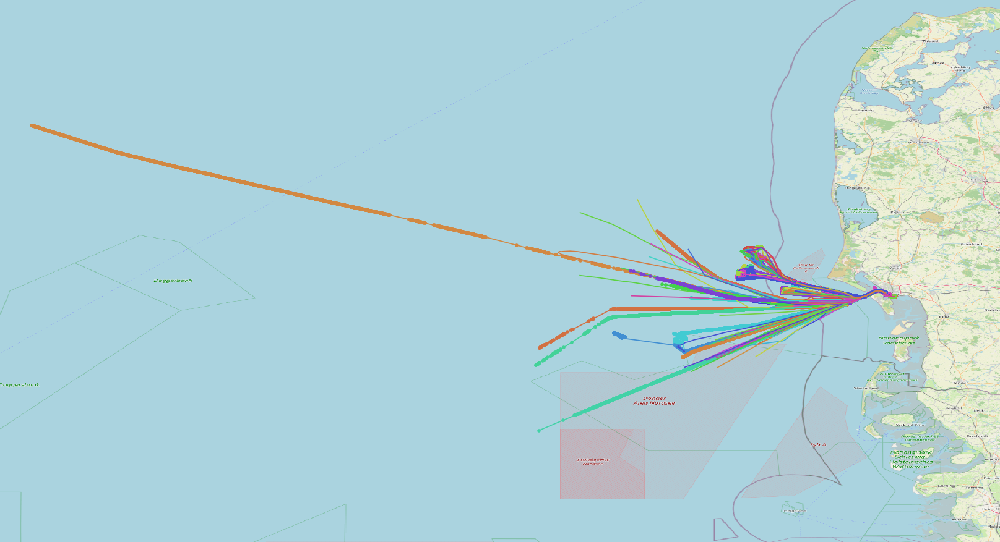
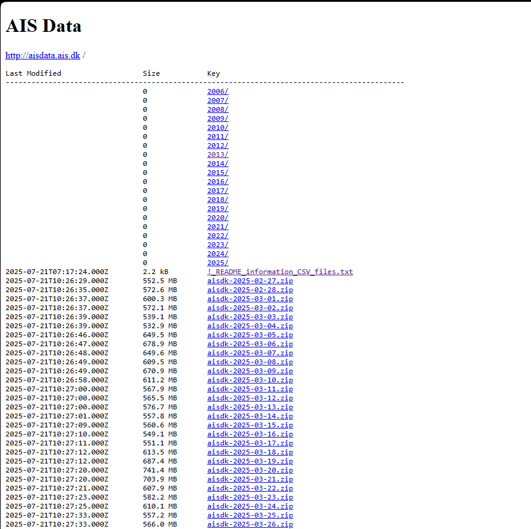
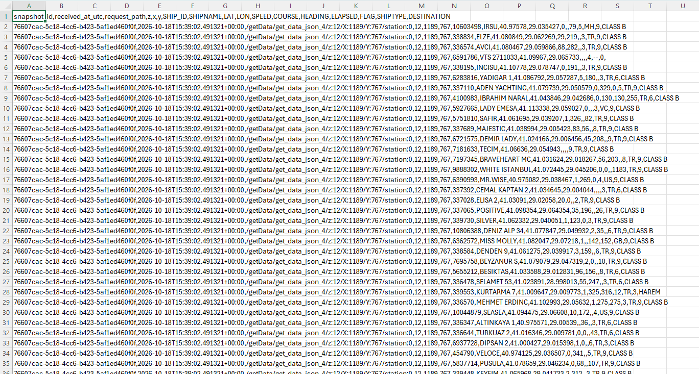
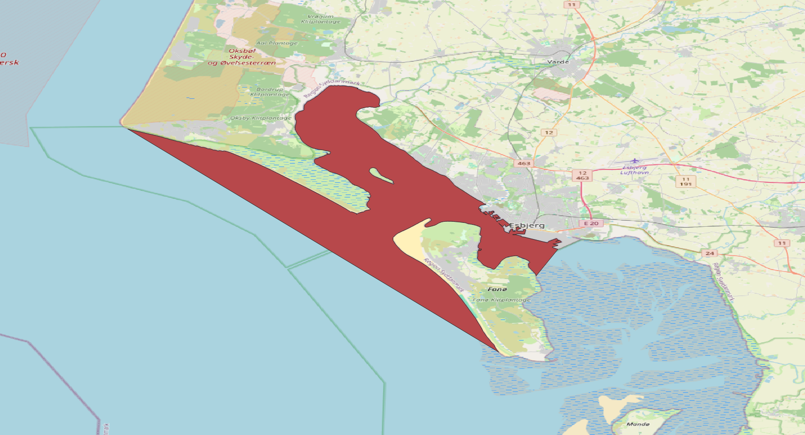
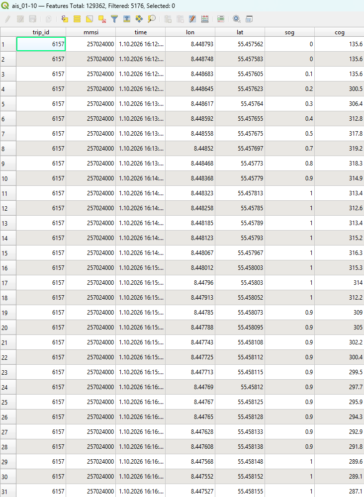
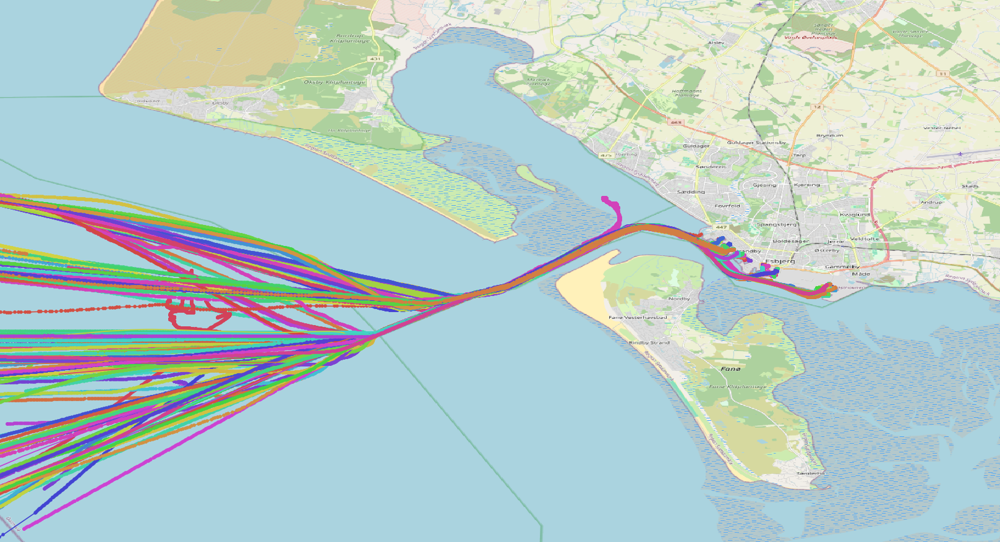
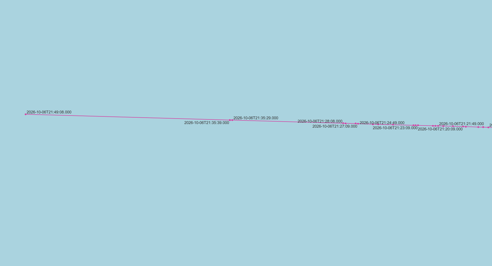

# AIS Path Filter

## Türkçe

QGIS’te geçmiş AIS kayıtlarından, seçtiğim bir alandan ayrılıp belirli bir yönde ilerleyen gemi seferlerini çıkarmak için bir Python betiği hazırladım. Araç farklı çalışma alanlarıyla kullanılabiliyor. Örnek olarak Esbjerg Limanı’ndan Kuzey Denizi’ne doğru batıya ilerleyen seferleri inceledim.



*Esbjerg çıkışında ortak bir kanalı izleyen seferler açık denize ulaştıklarında farklı kollara ayrıldı.*

### 1. AIS verisi ve tarih aralığı

Verileri Danimarka’nın [geçmiş AIS arşivinden](https://aisdata.ais.dk/) aldım. Günlük dosyalar `aisdk-YYYY-MM-DD.zip` biçiminde adlandırılmıştı. 1–27 Ekim 2026 arasındaki arşivleri indirdim ve içlerindeki CSV’leri bir ana klasör altında topladım.



Tarih aralığını [ais_path_filter.py](ais_path_filter.py) dosyasının başındaki şu satırlarda belirledim. Başka bir dönem için iki tarihi değiştirmek yeterli. Kod, başlangıç ve bitiş günlerini UTC olarak dahil etti. `csv_folder` boş bırakıldığında ana klasörü QGIS’te seçtim.

```python
csv_folder = ""
start_date = "2026-10-01"
end_date = "2026-10-27"
```

Kod Danimarka arşivindeki `Timestamp`, `Type of mobile`, `MMSI`, `Latitude` ve `Longitude` alanlarını bekledi. Aşağıdaki görselde ise farklı bir sağlayıcının CSV yapısını gösterdim. Bu dosyayı kullanmak için önce alanları uyarlamak ve `SHIP_ID` değerlerinin MMSI ile eşleştiğini doğrulamak gerekir.



### 2. Çıkış alanı, deniz maskesi ve hedef

Esbjerg örneğinde liman çıkış filtresi olarak [esbjerg.gpkg](examples/esbjerg.gpkg) dosyasını kullandım. Dosyanın içindeki poligon katmanının adı `esbjerg`. Kod, sefer adaylarını belirlemek için bu poligonun içindeki AIS gözlemlerini kullandı. Başka bir liman için `origin_layer_name` değerine yeni GeoPackage’taki poligon katmanının adı yazılabilir.

Deniz maskesiyle kara ve iç sulardaki kayıtları ayırmayı amaçladım. `sea_layer_name` alanına bir katman adı yazıldığında kod yalnızca bu poligonla kesişen AIS noktalarını işledi. Belirli bir açık deniz bölgesine ulaşmayı şart koşmak için `target_layer_name` ayarını ekledim. Hedef tanımlandığında kod, çıkış alanı dışında kaydedilmiş en az bir AIS noktasının hedef poligonla kesişmesini aradı. Bu koşul, hedef bölgeye ulaşan seferleri seçti ve seferin hangi limanda bittiği hakkında bir bilgi üretmedi.



*Liman ve kanal çevresindeki su poligonu. Açık deniz rotalarını korumak için kullanılan maske, incelenen deniz alanını da kapsamalı.*

```python
origin_layer_name = "esbjerg"
sea_layer_name = ""
target_layer_name = ""
exit_direction = "W"
```

Deniz maskesini ve hedef alanı isteğe bağlı bıraktım. Örnek GeoPackage’i çıkış filtresi olarak kullandım. Deniz maskesi için ayrı bir katman gerekir. Bunlardan birini kullanmak için ilgili GeoPackage katmanının adı boş alana yazılabilir. Yönü `W` (batı), `E` (doğu), `N` (kuzey) veya `S` (güney) olarak seçilebilir hale getirdim.

### 3. Seferleri nasıl seçtim?

Batıya giden seferleri seçerken geminin liman çıkışındaki hareketini de korumak istedim. Kod önce çıkış alanında gözlenen Class A ve Class B gemilerin MMSI’lerini buldu. İkinci taramada aynı gemilerin tarih aralığındaki alan dışı kayıtlarını da topladı ve her MMSI’nin konumlarını zaman sırasına koydu.

| Ölçüt | Örnek çalışmadaki ayar ve uygulaması |
| --- | --- |
| Çıkışın belirlenmesi | Kod alan içinde en az 60 saniyeye yayılan 2 kayıt ve çıkıştan sonra en az 3 kayıt aradı. Kabul edilen seferde son kesintisiz alan ziyaretini de korudu. |
| Batıya ilerleme | En az bir kayıt, poligonun en batı boylamından `0.01°` daha batıya geçti. Son alan içi konumdan ölçülen en büyük batı ilerlemesi en az 5 km’ye ulaştı ve en büyük kuzey-güney sapmasına eşit veya ondan büyük oldu. |
| Seferin bölünmesi | Kod, ardışık kayıtlar arasında 60 dakikadan uzun boşluk veya konumlardan hesaplanan 80 knot üzeri hız gördüğünde seferi kesti. |

Başlangıçta kısa bir süre batıya gidip sonra ağırlıklı olarak kuzeye veya güneye dönen seferleri ayırmak için ileri ve yanal ilerlemeyi karşılaştırdım. Kod yön kararını zaman sıralı AIS konumlarından verdi. `Heading` gemi burnunun baktığı yönü, `COG` yer üzerindeki hareket yönünü, `SOG` ise yer üzerindeki hızı gösterdi. Kod `COG` ve `SOG` değerlerini nokta çıktısına yazdı. Yönü veya konum sıçramasını belirlerken bu alanları eşik olarak kullanmadı.

```python
edge_margin_degrees = 0.01
min_forward_metres = 5000
min_forward_cross_ratio = 1.0
gap_minutes = 60
jump_knots = 80
```

### 4. QGIS’te çalıştırma ve çıktılar

Ana betiği QGIS Python Konsolu’nun editöründen çalıştırdım. Çıkış alanı sorulduğunda örnek `esbjerg.gpkg` dosyasını seçtim. İlk çalıştırmada **Reuse previous staged data** sorusuna **No** yanıtı verdim ve CSV’lerin ana klasörünü ve çıktı klasörünü seçtim. Kod, kabul ettiği seferlerin nokta ve çizgi katmanlarını QGIS’e ekledi.

| Çıktı | İçeriği |
| --- | --- |
| `trip_points.csv` / `ais_GG-AA` | Kabul edilen seferlerin zaman damgalı AIS noktaları. |
| `trip_paths.csv` / `path_GG-AA` | Noktaların zaman sırasıyla birleştirilmesiyle oluşan sefer çizgileri. |
| `direction_review.csv` | Her aday için ileri ve yanal ilerleme, sınır ve hedef koşulları ile kabul kararı. |
| `summary.json` | Kullanılan ayarlar ile çıkış alanında görülen benzersiz MMSI ve kabul edilen sefer sayıları. |



*Tablodaki `trip_id = 6157` satırları aynı seferin farklı zamanlardaki AIS noktalarını gösterdi. `mmsi` gemiyi, `trip_id` ise ilgili çalışmadaki seferi tanımladı.*

### 5. Sonuçları nasıl yorumladım?

Liman yakınındaki haritada seferlerin aynı kanal kesiminde toplandığını, açık denizdeki haritada ise farklı rotalara ayrıldığını gördüm. Çıkış alanının genişliği nedeniyle sonuçları seçtiğim alan ve yön koşullarına uyan **aday seferler** olarak değerlendirdim. Bir seferin belirli bir rıhtımdan başladığını doğrulamak için liman içindeki noktaları ayrı incelemek gerekir.



Zaman etiketli örnekte iki AIS gözlemi arasında 13 dakika 29 saniye vardı. Kod bu noktaları bir çizgiyle birleştirdi. Aradaki çizgiyi geminin gözlemlenmiş rotası olarak yorumlamadım, çünkü bu süre içinde alınan yolu gösteren kayıt yoktu.



---

## English

I wrote a Python script for QGIS to extract vessel trips that left a selected area and travelled in a specified direction from historical AIS records. The tool can be used with different study areas. As an example, I examined trips travelling west from Esbjerg Harbour into the North Sea.


*Trips followed a shared channel out of Esbjerg and branched once they reached open water.*

### 1. AIS data and date range

I obtained the data from the Danish [historical AIS archive](https://aisdata.ais.dk/). Daily files were named `aisdk-YYYY-MM-DD.zip`. I downloaded the archives for 1–27 October 2026 and gathered the extracted CSVs under one parent folder.


I set the date range in the following lines at the top of [ais_path_filter.py](ais_path_filter.py). To use another period, change the two dates. The script included both the first and last day in UTC. With `csv_folder` blank, I selected the parent folder in QGIS.

```python
csv_folder = ""
start_date = "2026-10-01"
end_date = "2026-10-27"
```

The script expected the Danish archive fields `Timestamp`, `Type of mobile`, `MMSI`, `Latitude` and `Longitude`. In the image below, I showed a CSV schema from a different provider. To use that file, first adapt its fields and verify that the `SHIP_ID` values map to MMSIs.


### 2. Origin area, sea mask and target

In the Esbjerg example, I used [esbjerg.gpkg](examples/esbjerg.gpkg) as the port departure filter. The polygon layer inside the file is named `esbjerg`. The script used AIS observations inside this polygon to identify candidate trips. For another port, set `origin_layer_name` to the name of the polygon layer inside the new GeoPackage.

I used the sea mask to separate marine observations from records on land and inland waters. When a layer name was entered in `sea_layer_name`, the script processed only AIS points that intersected that polygon. I added `target_layer_name` to require a trip to reach a specific offshore area. When a target was defined, the script looked for at least one AIS point recorded outside the origin that intersected the target polygon. This condition selected trips that reached the target area and provided no information about the port where the trip ended.


*Water polygon around the harbour and channel. To retain offshore tracks, the mask used should also cover the marine area under study.*

```python
origin_layer_name = "esbjerg"
sea_layer_name = ""
target_layer_name = ""
exit_direction = "W"
```

I left the sea mask and target optional. I used the example GeoPackage as the departure filter. The sea mask requires a separate layer. To use either one, enter the relevant GeoPackage layer name in the blank setting. I made the direction selectable as `W` (west), `E` (east), `N` (north) or `S` (south).

### 3. How I selected trips

When selecting westbound trips, I wanted to retain vessel movements through the harbour exit as well. The script first found the MMSIs of Class A and Class B vessels observed inside the origin. On the second pass, it also collected records outside the area for the same vessels and date range, and ordered each MMSI’s positions by time.

| Criterion | Setting and application in the example study |
| --- | --- |
| Departure detection | The script required 2 observations spanning at least 60 seconds inside the origin and at least 3 observations after the exit. For accepted trips, it also retained the last continuous visit inside the origin. |
| Westward progress | At least one observation passed `0.01°` west of the polygon’s westernmost longitude. The greatest westward progress from the last position inside the origin reached at least 5 km and equalled or exceeded the maximum north–south displacement. |
| Trip splitting | The script split a trip when consecutive observations were more than 60 minutes apart or the speed inferred from their positions exceeded 80 knots. |

I compared forward and lateral displacement to separate trips that initially travelled west and then turned mainly north or south. The script determined direction from the time-ordered AIS positions. `Heading` indicated where the bow was pointing, `COG` indicated course over ground, and `SOG` indicated speed over ground. The script wrote `COG` and `SOG` to the point output. It used none of these fields as thresholds for direction or position jumps.

```python
edge_margin_degrees = 0.01
min_forward_metres = 5000
min_forward_cross_ratio = 1.0
gap_minutes = 60
jump_knots = 80
```

### 4. Running in QGIS and outputs

I ran the main script from the QGIS Python Console editor. When prompted for the origin area, I selected the example `esbjerg.gpkg`. On the first run, I answered **No** to **Reuse previous staged data** and selected the parent CSV folder and the output folder. The script added point and line layers for accepted trips to QGIS.

| Output | Contents |
| --- | --- |
| `trip_points.csv` / `ais_DD-MM` | Timestamped AIS points for accepted trips. |
| `trip_paths.csv` / `path_DD-MM` | Trip lines formed by connecting the points in chronological order. |
| `direction_review.csv` | Forward and lateral displacement, boundary and target conditions, and acceptance decision for each candidate. |
| `summary.json` | Run settings, the number of distinct MMSIs seen inside the origin, and the number of accepted trips. |


*Rows with `trip_id = 6157` showed different AIS observations from the same trip. The `mmsi` identified the vessel, and the `trip_id` identified the trip within that run.*

### 5. How I interpreted the results

In the harbour close-up, I saw trips converge along the same channel segment. In the offshore overview, I saw them branch into different routes. Given the width of the origin area, I treated these results as **candidate trips** that met my area and direction criteria. Confirming that a trip started at a specific berth requires inspecting the observations inside the harbour separately.


In the timestamped example, two AIS observations were 13 minutes and 29 seconds apart. The script connected the points with a line. I did not interpret that segment as the vessel’s observed route because there were no records showing the path it took during that interval.


